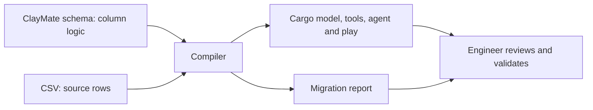

# Clay-to-Cargo Migration Compiler

A working prototype for engineers moving supported Clay workflows into Cargo. It reads a ClayMate schema, generates reviewable Cargo TypeScript, and reports provider substitutions, dropped inputs and unsupported columns.

**Real test:** a six-column Clay table was exported through ClayMate, compiled and run in Cargo. A hand-built implementation following Cargo's migration recipe also ran. Both saved matching company name, employee count, size flag and AI decision for one company. [Read the comparison](docs/REAL_CLAY_COMPARISON.md).

This extends Cargo's existing migration guidance. It is not an official Cargo product, a universal importer, or proof of faster onboarding.

## Try it locally

Install [Node.js 24 or newer](https://nodejs.org/) and Git, then:

```bash
git clone https://github.com/Rocker097/clay-to-cargo-migrator.git
cd clay-to-cargo-migrator
npm ci
npm run demo
npm test
npm run typecheck
npm run check
```

No Cargo account, API key or paid enrichment is needed for these local checks. You should see **6/6 columns migrated**, passing tests and **11 Cargo resources OK**.

Open `examples/generated/migrations/clay-demo-companies/MIGRATION_REPORT.md`, then the play under `examples/generated/infra/clay-demo-companies/plays/`.

`npm run demo` writes generated files locally. It does not import rows, deploy resources or run providers. Running `npm test` replays saved public-company values and tests the compiler; it does not make live calls.

## What goes in and out



A CSV carries values, not provider settings or run conditions. The schema supplies that logic. The accepted format is ClayMate version 1.0; a normal CSV alone cannot reconstruct the workflow. The CSV argument currently supplies row counts for reporting; row loading is a separate generated script.

Compile your own table from the repository root:

```bash
npm run compile -- \
  --schema /path/to/table.claymate.json \
  --csv /path/to/table.csv \
  --name my_table \
  --out /path/to/new-output-folder
```

Use a new output folder: generation overwrites files at matching paths. It emits resources and scripts, not a full Cargo scaffold or deployment state.

## Mapping

| Clay concept | Cargo output |
| --- | --- |
| Input | Native model column |
| Supported input formula | CSV-loader calculation |
| Company / person / email action | Reusable tool around a mapped action |
| Run condition | Tool guard |
| Separate conditional email rungs | Explicit fallback dependencies |
| Supported result formula | Expression saved by the play |
| AI column | Agent plus wrapper tool |
| CRM write | Omitted and reported |
| Unsupported action or formula | Manual-review report entry |

Provider substitutions can change results. AI model, settings and answer schema are adaptations requiring review; arbitrary AI settings are not preserved. The generated agent uses an Anthropic model that must be available in the destination workspace.

## What is proven

The real fixture came from a Clay table, not a hand-written schema. Its first compiler run generated only **1/6 columns**. Fixes added dependency ordering, the `company_identifier` input, common website normalization and primitive `Clay.formatForAIPrompt` prompt expressions. The repaired output generated **6/6** and completed a live company-only pilot.

| Saved value | Clay | Generated Cargo | Hand-built Cargo |
| --- | --- | --- | --- |
| Company name | Notion | Notion | Notion |
| Provider employee count | 7211 | 7211 | 7211 |
| Size flag (50–1000) | false | false | false |
| AI decision | NOT FIT, with explanation | NOT FIT | NOT FIT |

The employee count is a provider observation, not independently verified company data. AI decisions agree semantically; wording and output shapes differ. One company does not establish general parity, coverage or scale. [Method, costs and limitations](docs/REAL_CLAY_COMPARISON.md).

## Run it in your own Cargo workspace

Local validation comes first. For live execution, follow [the deployment guide](docs/LIVE_TEST.md). You need a signed-in Cargo workspace, available connectors, deployment state and credits. The generated play is disabled by default. Inspect the plan, load one company row and manually enroll only that row before considering a wider run.

There are no credentials, live deployment pointers, private workspace links or raw account traces in this repository.

## Scope and limits

- Supported formula subset: references, one field level, literals, arithmetic, comparisons, boolean operators, ternaries, DOMAIN (loader), COALESCE, IF, CONCATENATE, LOWER, UPPER, TRIM, CONTAINS and LEN.
- Prompt expressions support primitive formatting. Object formatting and unknown helper calls need manual review.
- Common HTTP(S) website normalization is covered; unusual identifiers and URLs need review.
- Action mappings are heuristic and finite. Native waterfall definitions, arbitrary exports, table relationships, arbitrary HTTP calls and full AI configuration preservation are unfinished.
- Email tools and conditional rungs can be generated. A successful real-person email waterfall was not tested in this comparison.
- CSV import creates rows; deduplication, safe reruns and importing existing enriched values remain unfinished.
- No automatic schedules, CRM writes or bulk enrollment are enabled by this demo.
- Live API schemas and costs can change. Dependencies are pinned to the tested versions, not automatically upgraded.

## Why build this alongside Cargo's skill?

Cargo's skill already explains how an agent can migrate a table. This experiment turns a supported subset of that translation into repeatable code generation with explicit gaps. The real comparison showed both approaches work; it did not demonstrate reduced engineering time or lower costs. The next benchmark should use unfamiliar tables and independently measure effort, fixes and correctness.

## Repository

- `src/`: parser, planner, mappings, code generation and parity reporting.
- `samples/`: sanitized real ClayMate schema and company-only inputs.
- `examples/generated/`: output created by `npm run demo`.
- `tests/`: regression tests and the observed Clay baseline.
- `docs/`: comparison, live testing and walkthrough.

Built by Afnan Saeed with AI assistance. Original prototype developed with Claude; deployment fixes, real-export validation and packaging developed with Codex. See [attributions](docs/ATTRIBUTION.md).
